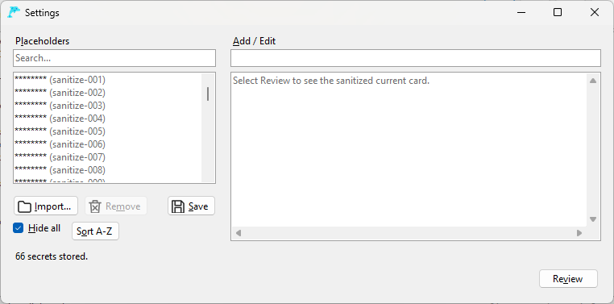

# Prompt Flipper

**Think before you paste. Sanitize before you share.**

Prompt Flipper is a **free, open-source, fully offline Windows application** for reusable AI
prompts. It replaces your own secrets with placeholders in one click before you paste a prompt
into an AI tool.

Keep your secrets local, your prompts reusable, and your information under your control.

**[Download free from Microsoft Store](https://apps.microsoft.com/detail/9PJSW6KZ5F63)** |
[Portable Windows executable](https://github.com/rckeller80/prompt-flipper/releases/latest/download/PromptFlipper.exe)


## Why Prompt Flipper?

AI prompts can contain more sensitive information than you realize.

Names, email addresses, customer information, internal project references, and other private
details can accidentally end up in prompts copied into ChatGPT, Copilot, Claude, or other AI
tools.

Manually checking every prompt is tedious and easy to forget.

**Prompt Flipper makes sanitizing prompts a one-click action.**

It combines a local secrets list that you manage, one-click sanitization, and a check for
personal details to help you reduce the risk of accidentally sharing sensitive information.

And it works entirely offline.

## Key Features

### One-click prompt sanitization

Select the **Sanitizer** button above the card text. Prompt Flipper replaces each of your saved
secrets with a named placeholder and copies the result to the clipboard. The editor shows the
placeholders, and a comic-style **Sanitized!** message confirms the action.

Select the button again to **De-Sanitize** and show the original values. The card file on disk
always keeps the original values.

No manual searching and replacing of every configured secret.

### Personal details check

**Review** in Settings checks the sanitized text for email addresses, phone numbers, Social
Security numbers and credit card numbers that are not sanitized yet. Select **Add as secret** or
**Add all** to sanitize them from then on.

The check is a safety aid, not a guarantee. Always review your sanitized content before sharing.

### Your secrets stay local

Maintain your own list of sensitive values in **Settings**, directly on your computer.



- Add a secret, or **Import** a text file with one secret on each line
- Each secret gets a placeholder name, such as `sanitize-001`
- Search the list, sort it with **Sort A-Z**, and mask the values on screen with **Hide all**
- Stored locally on your Windows device
- Protected with Windows data protection for your user account
- No cloud database or external processing

You decide what information the application replaces.

### Fully offline and private

Prompt Flipper requires:

- No account
- No internet connection
- No subscriptions
- No cloud services

It makes no network calls and sends no telemetry.

Your prompts, cards, settings, and secrets stay on your device.

See the [Privacy Statement](PRIVACY.md) for details.

### Reusable prompt cards

Prompt Flipper is also a lightweight prompt manager.

- Store prompts as ordinary `.md` text files in a folder you choose
- Flip through cards with **Previous** and **Next**, and keep open cards in tabs
- Search card names and text
- Edit, rename, add, and delete cards
- Add a new card from a template file
- Copy a card's text with one click
- Reuse prompts across different AI assistants

No proprietary cloud storage. Your prompt files remain yours.

### Simple interface

Privacy and productivity don't have to be complicated.

Two quick buttons above the card text do the main work. **Copy** copies the card text, and
**Sanitizer** copies a sanitized version. **Copy** shows a check mark when the text is on the
clipboard.

## Getting Started

### Installation

**Recommended: Microsoft Store**

[Install Prompt Flipper](https://apps.microsoft.com/detail/9PJSW6KZ5F63)

The Microsoft Store version is distributed as a Microsoft-signed MSIX package.

**Alternative: Portable executable**

[Download PromptFlipper.exe](https://github.com/rckeller80/prompt-flipper/releases/latest/download/PromptFlipper.exe)

- Requires 64-bit Windows
- No separate .NET installation required
- The portable executable is currently unsigned

Windows SmartScreen may warn about the unsigned portable version. On managed devices,
organizational security policies may require administrator approval.

### Basic usage

1. Launch Prompt Flipper.
2. Select **Attach Folder** (Ctrl+O) and choose the folder that contains your prompt cards.
3. Browse with **Previous** and **Next** (Alt+Left and Alt+Right), or use **Search** (Ctrl+F).
4. Edit the card text. Press Ctrl+S to save. Prompt Flipper also saves when you change cards or
   close the window.
5. Open **Settings** and add the secrets that you want the sanitizer to replace.
6. Select **Sanitizer** to copy a sanitized version of the card.
7. Review the result before you share it with an AI assistant or another person.

Use **Copy** when you want to copy the card text unchanged.

Press F1 for the built-in help and the full list of keyboard shortcuts.

## Card Format

A prompt card is an ordinary UTF-8 `.md` file.

The file name is the card title, and the file contains only the prompt text. Prompt Flipper
shows and edits the text as plain text. It does not render Markdown.

Example file: `Summarize a document.md`

```text
Summarize the following document in five bullet points.
Keep its dates, names and numbers.
```

You can edit these files with Prompt Flipper or any text editor.

Cards from earlier versions can start with a `tags:` line. Prompt Flipper hides that line and
removes it the next time it saves the card.

## Important: User-Controlled Privacy

Prompt Flipper helps reduce accidental exposure of sensitive information, but it is **not a
replacement for organizational data-loss prevention controls or careful review**.

Sanitization replaces only the secrets that you saved in Settings.

Always inspect the output before sharing.

## Open Source

Prompt Flipper is developed by **RC Keller** and released under the [MIT License](LICENSE).

Free to use, inspect, modify, and contribute to.

- [Source code](https://github.com/rckeller80/prompt-flipper)
- [Report a bug or suggest a feature](https://github.com/rckeller80/prompt-flipper/issues)
- [Version history](CHANGELOG.md)
- [Privacy statement](PRIVACY.md)

---

**Prompt Flipper: Think before you paste. Sanitize before you share.**

[Get Prompt Flipper free on Microsoft Store](https://apps.microsoft.com/detail/9PJSW6KZ5F63)
