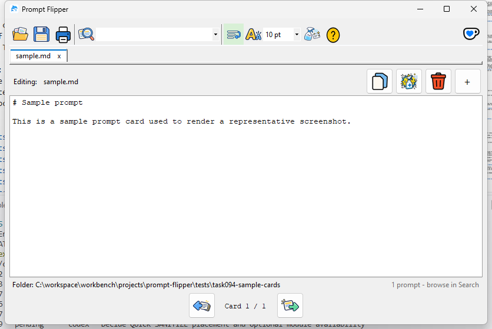

# Prompt Flipper

Prompt Flipper is a Windows app for saving and reusing prompts and notes as Markdown cards.
You can browse, edit and copy cards in one window.
Your cards stay on your device as ordinary files.
The app needs no account or network connection.



## Download

Download [PromptFlipper.exe](https://github.com/rckeller80/prompt-flipper/releases/latest/download/PromptFlipper.exe).
Run it on 64-bit Windows.
You do not need to install .NET.

### Code signing

The portable executable is unsigned.
The signed route is the Microsoft Store MSIX package, which Microsoft signs after certification.
Get it from the [Microsoft Store](https://apps.microsoft.com/detail/9PJSW6KZ5F63).

### Privacy

The app sends no data off your device.
See the [privacy statement](PRIVACY.md).

### Windows SmartScreen

The current executable is unsigned.
Windows SmartScreen may show a warning after a download.
If your device policy permits the file, remove its download mark with PowerShell:

```powershell
Unblock-File -LiteralPath .\PromptFlipper.exe
```

Use this command only for a file from an official download source.
Smart App Control or an organization's app policy can still block the file.
On a managed device, ask your administrator to approve the app.

## Use the app

1. Open `PromptFlipper.exe`.
2. Choose the folder that contains your cards.
3. Select **Previous** or **Next** to browse the cards.
4. Edit a card in the main editor.
5. Press Ctrl+S to save your changes.
6. Select **Copy** to copy the card text.

The app also saves your edits when you change cards or close the window.
Use **Search** to find a card in the selected folder.
Select **Open Folder** to choose another folder.

## Card format

Each card is a UTF-8 `.md` file whose file name supplies its title.
The first line contains `tags:` and comma-separated tags, followed by a blank line and the Markdown
body.

Example file: `Summarize a document.md`.

```markdown
tags: writing, summary

# Summarize a document

Summarize the following document in five bullet points.
Keep its dates, names and numbers.
```

## Version history

See the [changelog](CHANGELOG.md) for the changes in each version.

## Licence

Prompt Flipper uses the [MIT licence](LICENSE).
Official downloads come from this repository or its [Microsoft Store listing](https://apps.microsoft.com/detail/9PJSW6KZ5F63).
